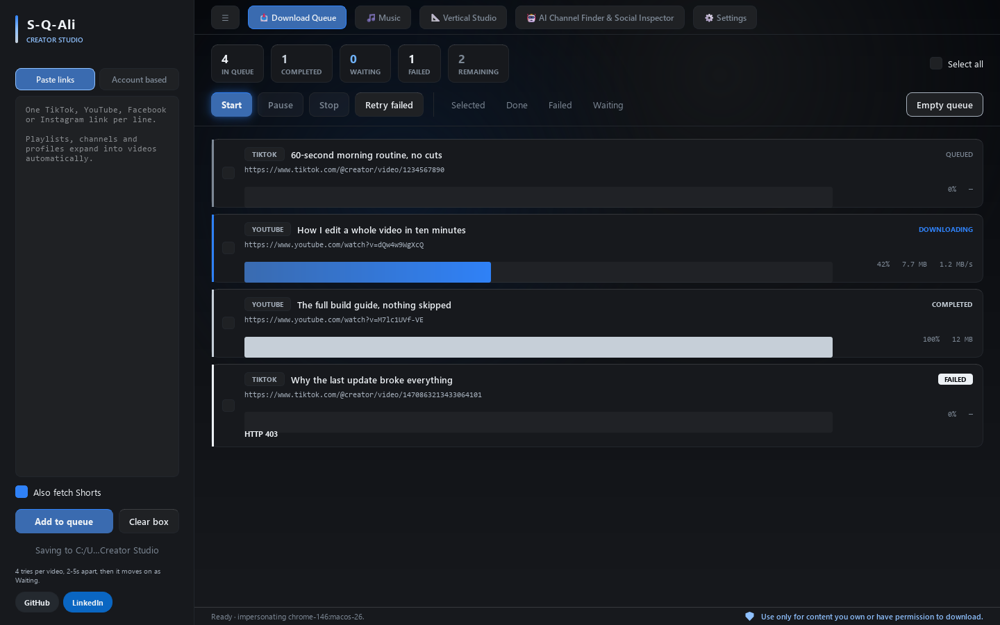
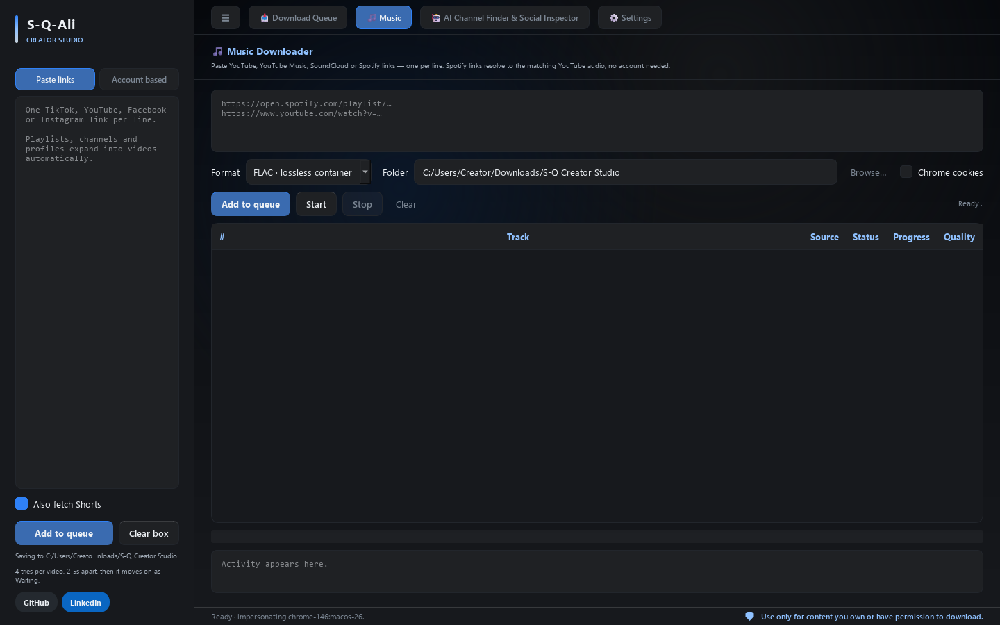
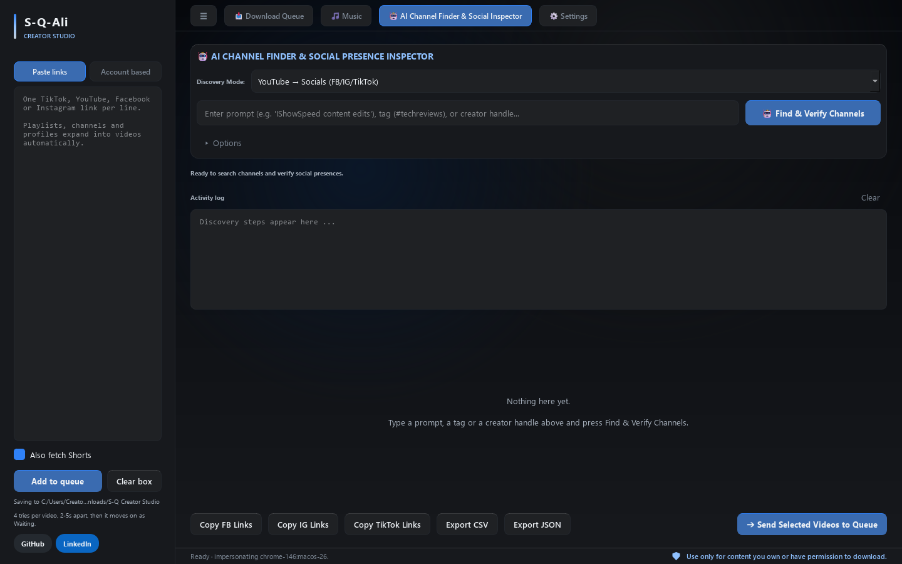
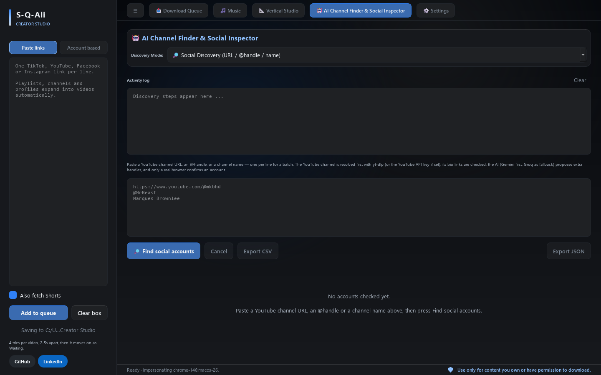
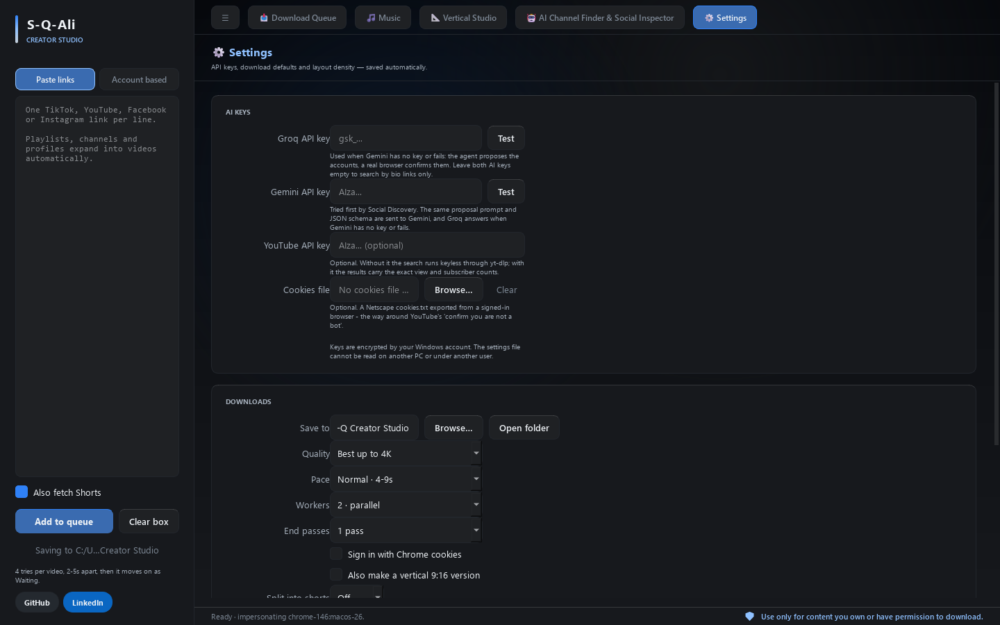
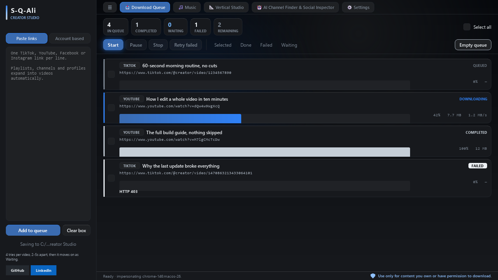

# S-Q Creator Studio

[](https://github.com/S-Q-Ali/S-Q-Creator-Studio/releases)
[](LICENSE)
[](https://github.com/S-Q-Ali/S-Q-Creator-Studio/actions)
[](https://www.python.org/downloads/)
[](#install)

Bulk-download **TikTok**, **YouTube**, **Instagram** and **Facebook** videos, pull the **audio** behind any YouTube, YouTube Music, SoundCloud or Spotify link, and find a creator's Facebook, Instagram and TikTok accounts — one queue-based desktop studio. Every account is confirmed in a real browser, not just guessed by an AI. Open source, free, and no activation keys — ever.

**[Quick Start](#quick-start)** | **[Features](#features)** | **[Install](#install)** | **[Build from Source](#build-from-source)** | **[FAQ](#faq)** | **[Roadmap](#roadmap)**

---

## 🚀 Quick Start

Download the latest release and start downloading videos in seconds:

1. Download the build for your platform — Windows, Linux or macOS — from [Releases](https://github.com/S-Q-Ali/S-Q-Creator-Studio/releases)
2. Install or unpack it (the Windows installer needs no admin rights)
3. Paste TikTok, YouTube, Facebook or Instagram links
4. Click Start

**Or build from source** - See [Build from source](#build-from-source) section.

---

## 📸 Screenshots

| Main Interface | Music |
|----------------|-------|
|  |  |

| AI Channel Finder | Social Discovery |
|-------------------|------------------|
|  |  |

| Settings | Compact Mode |
|----------|--------------|
|  |  |

---

## Features

- **TikTok & YouTube** in one queue — links are detected automatically and run through per-platform download settings. Instagram and Facebook post links are queued too, without the per-platform tuning TikTok gets.
- **YouTube playlists & channels** expand into individual videos in the background.
- **Instagram profiles** expand into their video posts and reels. Only public profiles — no sign-in, and no account is ever stored. Instagram slows the walk down on purpose, so a listing stops after three minutes and tells you how far it got.
- **Facebook pages** expand into their videos — *experimental*: the page's Videos tab is read in the app's own browser, and the page's own query pages the rest of the list behind it. Only public pages — no sign-in, and no Facebook session is ever stored.
- **Music workspace** — its own tab for audio. Paste YouTube, YouTube Music, SoundCloud or Spotify links, one per line; a playlist or an album resolves into its tracks in one click. Choose FLAC (default), MP3 320, M4A, Opus or WAV; a quality report says what the source stream really was (YouTube serves lossy audio, so FLAC is a container, not recovered detail). Files land where the link pointed: a collection link — album, playlist or YouTube set — puts all its tracks in that collection's folder as `Collection/NN - Title`, and a single track link uses `Artist/Album/NN - Title`. Spotify links carry metadata rather than audio: it is read anonymously and every title is matched to its YouTube version by yt-dlp's own search — no Spotify account, password or API key. Artwork comes with the link's own metadata: a track or an album brings its cover, and so does a YouTube or SoundCloud link (its thumbnail); a **Spotify playlist** row carries no album and no cover in the free endpoint, so those files are tagged by artist and title only — they still land in the playlist's folder.
- **Queue management** — add, select, remove, retry, empty. Saved between sessions.
- **Worker pool** — 1–3 parallel downloads with per-worker pacing delays.
- **Automatic retries** — 4 tries per video on the spot, plus optional end passes over the stragglers.
- **Quality presets** — **Best up to 4K** by default (the best the source really offers, capped at 2160p), then 1440p/1080p/720p/480p, **Best available** (no cap), plus **Audio only** (MP3 via bundled ffmpeg). A 4K stream is VP9 or AV1, so it is muxed into an **MKV** — an MP4 that carries them is refused by half the players — and the queue card names the resolution and codec that came down.
- **Vertical 9:16 that follows the subject** — tick **Also make a vertical 9:16 version** and every download also lands as `<name>_9x16.mp4` beside the original: a 9:16 window cut out of the *picture*, so the black bands of a letterboxed film stay out, and the window tracks the person in the frame — a face if there is one, a body if there is no face, and where neither answers it holds the position it had. It sits still while the subject does, glides when the subject moves, and takes the new framing the moment the picture cuts instead of panning across the cut, the output is at most 1080×1920, and the audio is the original track copied, so it cannot drift out of step. It is two extra passes over the video, and they are measured: on a 4K download the whole pass costs about 4 s of work per second of film, so a 37-minute one lands in roughly 2½ hours. Off by default, and a reframe that fails leaves the download as it is.
- **Long videos into shorts** — **Split into shorts** cuts each download at the pauses in the speech, or at a change of scene where no pause is near. **Auto** uses the scene changes; **30 s / 45 s / 60 s / 90 s** use that length; **N clips** takes the number you want (2–30), divides the length by it and moves each cut to the nearest pause — the app names the length it will use before it starts. Clips land as `<name>_short01.mp4`, and with the vertical box ticked each clip gets its own `_9x16` too.
- **Account based** — paste a public TikTok profile and pull its newest video URLs for review. The same button takes an Instagram profile or a Facebook page.
- **Browser impersonation** — TikTok requests are signed with a real Chrome identity so rate-limit failures are far less likely.
- **AI Channel Finder & Social Inspector** — one tab with three modes: **YouTube → Socials**, **TikTok → YouTube / Facebook / Instagram**, and **Social Discovery**, which takes a channel URL, a handle or a name and finds the creator's other accounts. Uses a keyless yt-dlp search by default; an optional YouTube Data API key lifts quota walls.
- **Every account is checked twice** — the AI proposes a link and a real browser opens it, then the two answers are reconciled. Neither one is trusted on its own; found, not found and unknown are told apart.
- **Search-grounded answers** — Gemini is asked with Google Search turned on, so the proposal comes from a real search result instead of the model's memory. Groq answers when Gemini has no key or fails. TikTok walls its tag listing even for a signed-in cookie file, so the TikTok mode works from creators you paste — `@handles` or profile URLs, one per line or comma-separated — and checks each one on YouTube, Instagram and Facebook.
- **A browser that does not look like a bot** — `navigator.webdriver` and the one-language `navigator.languages` are the two tells a platform can read without guessing; the app hides both.
- **Operation log** — every step writes one line: the stage, the engine that did it, the link it touched and how long it took. The search budget is in there too.
- **Glass theme** — black, white, grey and one blue: opaque panels over a lit dark base, with status carried by a spine on each card. Built with PySide6.
- **Fits a small laptop** — the layout has a compact density that switches on below 1500×850, so nothing is clipped on a 1280×720 screen.

> Only download content you own or have permission to download.

## Install

Every release ships a build for each desktop platform it tests. Get yours from
the [latest release](https://github.com/S-Q-Ali/S-Q-Creator-Studio/releases):

| Platform | File | |
|---|---|---|
| Windows 10/11 (x86_64) | `S-Q-Creator-Studio-Setup-*.exe` | Installer, no admin rights needed |
| Windows 10/11 (x86_64) | `S-Q-Creator-Studio-*-windows-x64.zip` | Portable folder |
| Linux x86_64 | `S-Q-Creator-Studio-*-linux-x64.tar.gz` | Portable folder |
| macOS 15+ (Apple Silicon) | `S-Q-Creator-Studio-*-macos-arm64.tar.gz` | Portable `.app` |
| macOS 15+ (Apple Silicon) | `S-Q-Creator-Studio-*-macos-arm64.dmg` | Disk image — drag into Applications |
| macOS 15+ (Intel) | `S-Q-Creator-Studio-*-macos-x64.tar.gz` | Portable `.app` |
| macOS 15+ (Intel) | `S-Q-Creator-Studio-*-macos-x64.dmg` | Disk image — drag into Applications |

**What CI proves, and what it does not.** Each archive is built on its own
platform's runner, and there the offline suite passes and the frozen app is
launched and stays up — at Python 3.12 and 3.14, on `windows-latest`,
Ubuntu 24.04, macOS 14 (Apple Silicon) and macOS 15 Intel. The Linux build
needs glibc 2.34 or newer, which is what the bundled PySide6 wheels support;
other distributions and older macOS releases are unbuilt and untested. Nothing
here is signed or notarised, so Windows will warn on the installer's first run
and macOS will refuse the app until you approve it in System Settings →
Privacy & Security. The `live` tests, which hit TikTok and YouTube servers,
never run in CI.

### Windows: installer (recommended)

Download the newest `S-Q-Creator-Studio-Setup-*.exe` from the [latest release](https://github.com/S-Q-Ali/S-Q-Creator-Studio/releases).

- Per-user install — **no administrator rights needed**.
- Bundles `ffmpeg.exe`, so audio-only extraction and format merging work out of the box.
- Bundles the full Chromium build, so Social Discovery works even where no browser is installed.
- Installs Start-menu and (optional) desktop shortcuts, plus an uninstaller.

The portable Windows build is the same app in a zip — unzip and run
`S-Q Creator Studio.exe`. It needs the `_internal` folder to stay next to it.
System ffmpeg is used if present on `PATH`.

### Linux and macOS

Unpack the archive into an empty folder and run what is inside it:
`S-Q Creator Studio` on Linux, `S-Q Creator Studio.app` on macOS. The files next
to the launcher belong there — the app reads them on start-up. Both archives
carry their own Chromium and ffmpeg, so Social Discovery and merged downloads
work on a machine that has neither installed. Your API keys go to the machine's
own keychain: the login keychain on macOS, the secret service the desktop offers
on Linux (GNOME Keyring or KWallet).

On a Mac, the `.dmg` is the easier way in: open it and drag
`S-Q Creator Studio` onto the `Applications` shortcut, then launch it from
Applications. The `.tar.gz` is the same app for anyone who prefers to unpack it
by hand. Both are unsigned until the signing work lands, so macOS asks you to
approve the app once — right-click it and choose **Open**, or allow it in
System Settings → Privacy & Security.

The two Mac files are separate builds: `macos-arm64` is for Apple Silicon and
`macos-x64` is for Intel. Rosetta 2 runs Intel software on Apple Silicon, but
not the other way round, so an Intel Mac needs the `x64` build. Both need
macOS 15: the Qt libraries the app ships declare that as their minimum, and
macOS refuses to load a library built for a newer release.

## Build from source

Requires Python 3.12 or newer — the versions CI runs the offline suite on are
3.12 and 3.14, and each release is built on 3.14.

```powershell
git clone https://github.com/S-Q-Ali/S-Q-Creator-Studio.git
cd S-Q-Creator-Studio

python -m venv .venv
.\.venv\Scripts\activate      # Linux and macOS: source .venv/bin/activate
pip install -r requirements.txt

# Social Discovery drives a real browser. Chrome or Edge is used when the
# machine has one; otherwise install the fallback:
playwright install chromium

# run
python -m s_q_ali_media_downloader      # from the repo root (src/ is on the package path)
# or
pip install -e .
s-q-ali-media-downloader

# test + lint
pip install -r requirements-dev.txt
pytest -m "not live"        # the live tests hit the network; run them with `pytest -m live`
ruff check src tests

# build the portable app for the OS you are on — this is what CI runs
python release/build.py   # PyInstaller onedir; on Windows it then compiles
                          # the installer with Inno Setup. It also stages
                          # ffmpeg and the bundled Chromium next to the app
```

The packaging flags PyInstaller actually needs live in `release/build.py`
(`--collect-all` for `yt_dlp`, `curl_cffi`, `playwright`, `instaloader`,
`mutagen`, `SpotipyFree`, `spotapi`, `browser_use` and friends). Building with a
hand-rolled `pyinstaller` command tends to produce an app that starts and then
fails to import one of those at runtime, so prefer the script.

One script builds all three platforms: the data-path separator, the ffmpeg file
name, the browser cache folder, the launcher name and the keyring collection
follow the OS doing the build. `release\build.bat` is the Windows entry point
that starts it, and the installer step is skipped off Windows because Inno Setup
is a Windows program.

## How downloads work

Each link is tried 4 times on the spot (2–5 s apart). Stills-failing links are marked **Waiting**, and optional end passes sweep them again after a cooldown. Errors that can never succeed — deleted, private, region-blocked — fail immediately instead of wasting retries.

YouTube and TikTok links are handled separately: TikTok uses Chrome impersonation, YouTube skips it and uses native format selection. Instagram and Facebook post links go through yt-dlp's own extractors, without the per-platform tuning TikTok gets. `Audio only` post-processes to MP3 with the bundled ffmpeg.

Two optional passes run over a video after it lands. **Split into shorts** finds the pauses in the speech and the changes of scene, then cuts at whichever sits nearest the point the maths asked for. **Also make a vertical 9:16 version** looks for the subject in the frame — a face first, a full body when there is no face to find, and where neither answers the window holds the position it had. The looking runs on a 1920-wide, five-frames-a-second copy of the film rather than the file itself, which costs a fifth of the work; the window is placed back in the file's own size, and the audio is copied, not re-encoded. Measured on a 4K download, the whole vertical pass is about 4 s of work per second of film — a 37-minute film in roughly 2½ hours.

Music works the same way in its own tab: the links are resolved into tracks first — yt-dlp for YouTube, YouTube Music and SoundCloud, spotipyFree for Spotify metadata — then each track takes the best audio stream and converts it to the chosen codec with the bundled ffmpeg. Tracks are pulled one after another, and the tags and whatever artwork the source carries are embedded before each file moves. A collection link (album, playlist or YouTube set) files its tracks in that collection's folder; a single track link files under `Artist/Album/`.

## Settings

Everything is in the **Settings** tab of the app.

| Setting | What it does |
|---|---|
| **Gemini API key** | Tried first by Social Discovery, with Google Search turned on so the answer comes from a real search result. |
| **Groq API key** | The second opinion. Used when Gemini has no key or fails; the model only *proposes* accounts, a real browser confirms them. Leave both AI keys empty to search by bio links only. |
| **YouTube API key** | Optional. Without it the search runs keyless through yt-dlp; with it the results carry exact view and subscriber counts. |
| **Cookies file** | Optional. A Netscape `cookies.txt` exported from a signed-in browser — the way around YouTube's "confirm you are not a bot". |
| **Save to / Quality / Pace / Workers / End passes** | Where the videos land and how hard the app works. |
| **Also make a vertical 9:16 version** | Each download gets a `<name>_9x16.mp4` beside it, the crop window following the person in the frame. Two extra passes over the video, so a long one takes its time. |
| **Split into shorts** | **Off** by default; **Auto** cuts at the scene changes, a fixed length cuts at the nearest pause to it, and **N clips** divides the length by the number you pick and says what each clip will be before it starts. |
| **Compact layout** | Follows the window by default: below 1500×850 the interface tightens itself so nothing is clipped on a small laptop. Tick the box to choose it yourself. |

On Windows the API keys are sealed at rest with DPAPI — stored encrypted and tied to your Windows account, not to the machine — and no key is ever written to a URL or to the log. Off Windows the store asks the machine's own keychain (the login keychain, GNOME Keyring, KWallet) through `keyring` and keeps only the item's name in the database. Where no secret store answers, the row is marked `plain:` and the Settings page says so instead of pretending the key is safe.

What has actually run where: the store resolves its backend on Linux and macOS in CI, which builds and launches the app there — but a CI runner is not a desktop. The sealed round-trip through a real user keychain is covered by tests against a stand-in keychain, and it is your machine that runs it against a live one first. A keychain that refuses the app is a bug: open an issue with the OS and the desktop. DPAPI and the keychains are both tied to your login; they defend a stolen disk, not someone already sitting in your account.

## Tech stack

- **PySide6** — Qt 6 desktop UI
- **yt-dlp** — extraction and download engine
- **curl_cffi** — TLS fingerprint impersonation for TikTok (`>=0.15,<0.16`)
- **instaloader** — lists an Instagram profile's posts (yt-dlp's own Instagram extractor is broken upstream)
- **opencv-python-headless** — the face and body detectors behind the vertical 9:16 version; two ONNX models of about 1.3 MB, in a wheel of roughly 110 MB unpacked
- **mutagen** — artwork and tag embedding for the music files
- **spotipyFree** — anonymous Spotify metadata for the Music tab: no login, no client ID
- **httpx / pydantic / beautifulsoup4** — discovery HTTP, typed schemas, bio scraping
- **Playwright** — the real browser that confirms every account
- **browser-use** *(optional)* — the AI-agent browser for the pages a script cannot read; it starts its own browser session on the app's persistent profile rather than riding the hardened Playwright session
- **PyInstaller** — standalone EXE packaging
- **Inno Setup** — per-user installer
- **pytest / ruff / GitHub Actions (pip-audit gate)** — tests, lint, CI

## ❓ FAQ

### Common Issues

**Q: "Bot check" error on YouTube?**
A: Export cookies from your signed-in browser:
1. Open Chrome/Edge → Developer Tools (F12) → Application → Cookies
2. Find `youtube.com` cookies
3. Export as `cookies.txt` format
4. Set path in Settings → Cookies file

**Q: Social Discovery fails to verify accounts?**
A: Check these:
- A Gemini API key set in Settings (Groq answers when Gemini has none or fails)
- Browser installed (Chrome or Edge recommended)
- Internet connection stable
- Account actually exists (try visiting the URL directly)

The operation log says which of the two checks answered, and which one did not.

**Q: Downloads fail with "Deleted or Private"?**
A: These videos cannot be downloaded. They're marked as **Waiting** but won't retry to save bandwidth.

**Q: App won't start or crashes?**
A: Try these:
- Reinstall the app
- Check Python 3.12+ installed (if running from source)
- Ensure ffmpeg is accessible (check `PATH`) — every build ships its own beside the app
- Verify output directory is writable

**Q: Which quality options are available?**
A: **Best up to 4K** (the default — the best the source offers, up to 2160p) → 1440p → 1080p → 720p → 480p, plus **Best available** (no cap) and **Audio only** (MP3). A video that has no 4K stream comes down at the best it does have; the card says which one that was.

---

## 🛣️ Roadmap

### Q4 2026
- [ ] Twitch video downloader
- [x] Instagram & Facebook bulk downloading — expand a profile into its posts, and tune the requests the way TikTok's are
- [x] Music workspace — audio from YouTube, YouTube Music, SoundCloud and Spotify links, tagged and filed by collection or artist/album
- [ ] Mobile companion app (Android)

### Q1 2027
- [ ] Download history & statistics dashboard
- [ ] Cloud sync (optional, encrypted)
- [ ] Batch download optimization

### Future
- [ ] Master-key sealing for API keys — a 256-bit key derived from a password you
      type, instead of DPAPI or the OS keychain, so the secrets stop depending on
      your login and there is no `plain:` fallback on a machine with no keychain
- [ ] AI-powered video recommendations
- [ ] Multi-language UI (i18n)
- [ ] Browser extension for quick add

---

## 🙏 Acknowledgments

This project wouldn't be possible without these amazing libraries and tools:

- **[yt-dlp](https://github.com/yt-dlp/yt-dlp)** - Powerful video extraction engine
- **[PySide6](https://pypi.org/project/PySide6/)** - Qt 6 Python bindings for desktop UI
- **[curl_cffi](https://pypi.org/project/curl-cffi/)** - TLS fingerprint impersonation for TikTok
- **[httpx](https://www.python-httpx.org/)** - Modern HTTP client for async requests
- **[Pydantic](https://docs.pydantic.dev/)** - Data validation and settings management
- **[BeautifulSoup4](https://www.crummy.com/software/BeautifulSoup/)** - HTML/XML parsing
- **[Playwright](https://playwright.dev/python/)** - The real browser that confirms every account
- **[instaloader](https://instaloader.github.io/)** - Lists an Instagram profile's public posts
- **[Gemini](https://ai.google.dev/)** - Google Search grounding for the first opinion
- **[Groq LLM](https://groq.com/)** - The second opinion, and the model that browses the web
- **[Inno Setup](https://jrsoftware.org/isinfo.php)** - Windows installer creation
- **[PyInstaller](https://www.pyinstaller.org/)** - Standalone EXE packaging
- **[pytest](https://docs.pytest.org/)** - Testing framework
- **[Ruff](https://docs.astral.sh/ruff/)** - Fast Python linter

---

## 🤝 Contributing

Contributions are welcome! Please read our [Contributing Guidelines](CONTRIBUTING.md) before submitting pull requests.

For bugs or feature requests, please use our [issue templates](.github/ISSUE_TEMPLATE/).

---

## 🔒 Security

We take security seriously. Please see our [Security Policy](SECURITY.md) for vulnerability reporting guidelines.

---

## Links

- **GitHub:** https://github.com/S-Q-Ali/S-Q-Creator-Studio
- **LinkedIn:** https://linkedin.com/in/s-qasim-ali
- **Report Bug:** [Issues](https://github.com/S-Q-Ali/S-Q-Creator-Studio/issues)
- **Request Feature:** [Issues](https://github.com/S-Q-Ali/S-Q-Creator-Studio/issues)

---

## License

[MIT](LICENSE) - Free to use, modify, and distribute.

---

> **⚠️ Disclaimer:** Only download content you own or have permission to download. The developer is not responsible for misuse of this tool. Please respect copyright laws and terms of service of the platforms you use.
